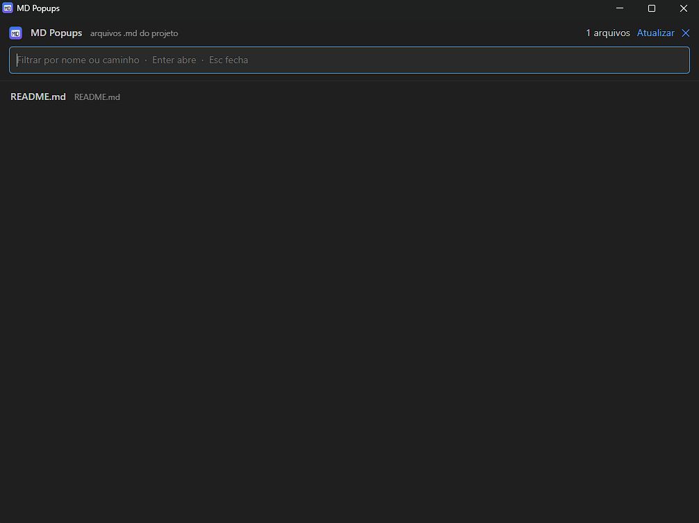

# MD Popups

Extensão do VS Code que lista todos os arquivos Markdown (`.md`) do seu código em uma janela pop-up flutuante e abre o conteúdo renderizado.

## Comandos

| Comando | Atalho | O que faz |
| --- | --- | --- |
| `MD Popups: Lista de arquivos Markdown` | `Ctrl+Alt+M` (`Cmd+Alt+M` no macOS) | Abre a janela pop-up com a lista filtrável dos `.md` do workspace. |
| `MD Popups: Abrir este Markdown na janela pop-up` | — | Abre o arquivo selecionado (Explorer ou editor ativo) na janela pop-up. |
| `MD Popups: Abrir Markdown no editor` | — | Abre o arquivo Markdown no editor padrão. |

No Explorer, o item aparece no menu de contexto de arquivos `.md`.

## Comportamento

- **Abertura automática:** ao abrir a pasta do projeto (que contenha `.md`), a janela com a lista abre sozinha. Desative em `Settings → MD Popups: Auto Abrir` (`mdPopups.autoAbrir`).
- **Lista com filtro:** a janela mostra somente arquivos `.md`; digite para filtrar por nome ou caminho, `Enter` abre o primeiro resultado, `Esc` fecha a janela.
- **Documento:** `←` volta para a lista, **Atualizar** recarrega, **Abrir no editor** leva ao editor (`vscode://file/...`). O conteúdo se atualiza sozinho ao salvar o arquivo.

## Como funciona

1. A extensão sobe um servidor local (`127.0.0.1`, porta aleatória, com token) dentro da Extension Host.
2. A janela pop-up é o `Edge`/`Chrome` em modo app (`--app`), usando as cores do tema atual do VS Code.
3. `Esc` ou o `✕` fecha a janela, encerra o processo do navegador e derruba o servidor.
